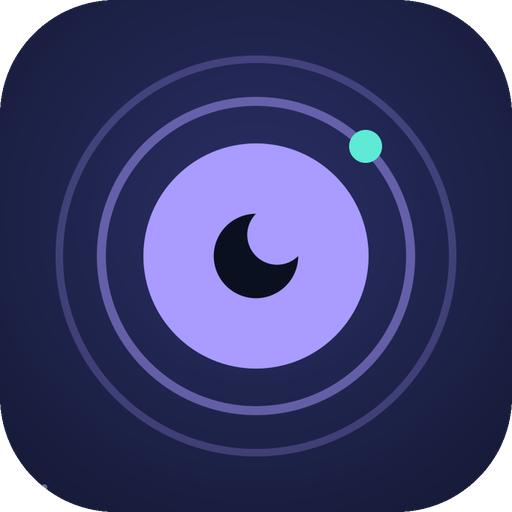
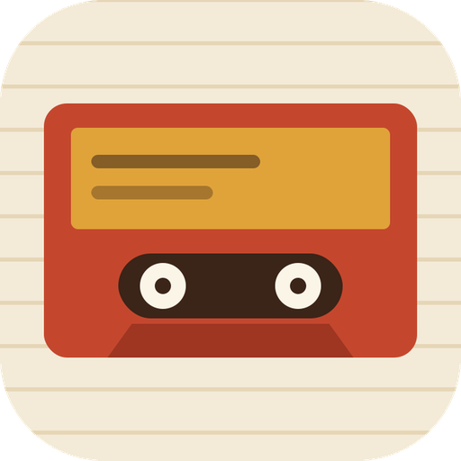
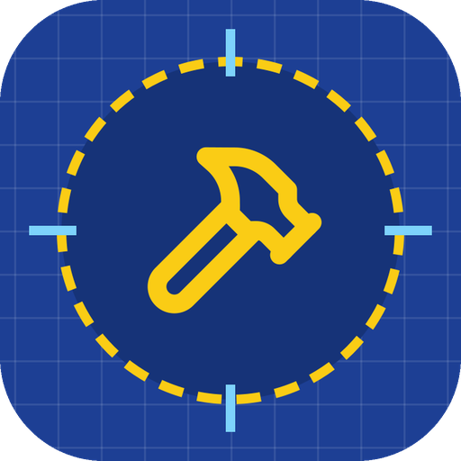
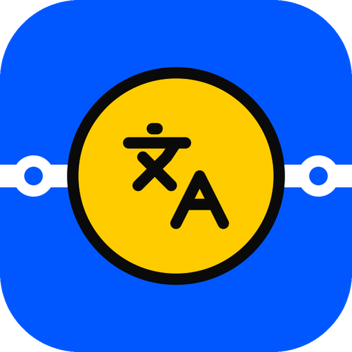
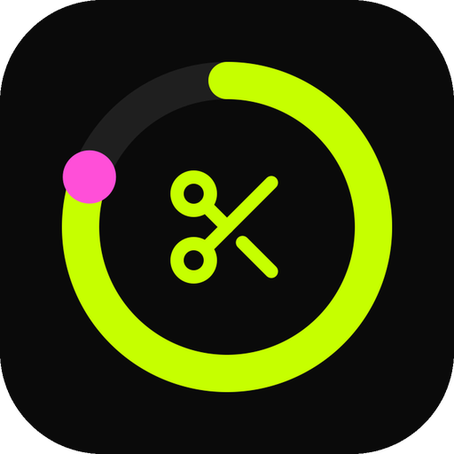
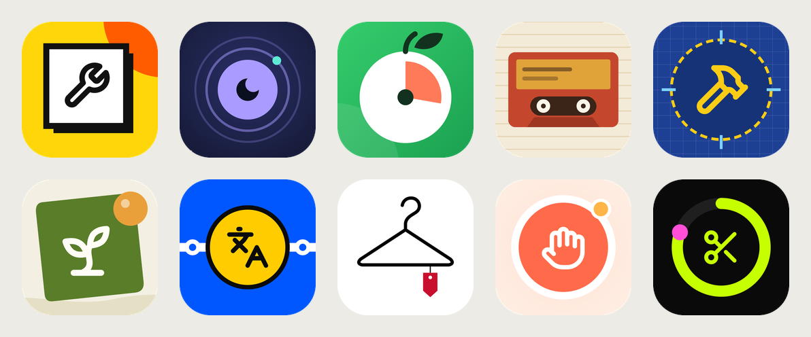

# Ten Apps

Ten mobile app concepts. Each has its own fonts, colors and layout, and each is a clickable prototype with 8 screens: onboarding, home, a second tab, a detail screen, a 3-step create flow, review, confirmation, and profile & settings. It implements `project/App Prototypes v2.dc.html`, the Claude Design handoff described in `DESIGN_HANDOFF.md` and `chats/`.

| | App | Style |
|:-:|---|---|
|  | **Lendr**: borrow tools from neighbors | Neo-brutalist · Archivo Black / Space Mono |
|  | **Hush**: find a quiet place | Night calm · Instrument Serif / DM Sans |
|  | **Use-By**: use food before it expires | Fresh & chunky · Bricolage Grotesque |
|  | **Kin Tapes**: family oral history | Vintage cassette · Playfair Display / Courier Prime |
|  | **Mend**: repair before replace | Blueprint · IBM Plex Sans / Plex Mono |
|  | **Plotswap**: trade garden surplus | Organic garden · Young Serif / Nunito |
|  | **Ride Lingo**: lessons sized to your commute | Transit signage · Barlow Condensed / Barlow |
|  | **Wear Count**: cost per wear | Fashion editorial · Bodoni Moda / Jost |
|  | **Still Here**: daily check-in for people living alone | Warm & accessible · Nunito |
|  | **Trialtrap**: forgotten subscriptions | Neon fintech · Space Grotesk / JetBrains Mono |

**Get the APKs:** open this repository's **Releases** page. The newest "Ten Apps N" release has one `<app>.apk` per app; download it on your phone and install it. `.github/workflows/ten-apps.yml` builds all ten on every push that touches this folder. Package names are `com.udapps.<slug>`, e.g. `com.udapps.hush`.

## Run it

```bash
npm install
npm run dev                         # the prototype viewer: app picker, phone frame, jump-to-screen
VITE_APP=1 npm run dev              # one app full-screen, as packaged in its APK (1 = Hush; index into apps.json)
npm run build                       # typecheck + build
```

## Build one APK locally

Needs JDK 21 and the Android SDK (`ANDROID_HOME`), plus `pip install pillow`.

```bash
VITE_APP=1 npx vite build
APP=hush npx cap add android        # android/ is generated, not committed
python3 tool/prepare_android.py hush
cd android && ./gradlew assembleDebug   # app/build/outputs/apk/debug/app-debug.apk
```

In a single-app build the Android back button walks back through the screens and closes the app from home. Fonts are bundled, so the apps work offline, and each APK carries only its own fonts (`src/fonts/app-<n>.ts`). App state is saved on the phone.

## Icons

`python3 tool/make_icons.py` (needs `pip install cairosvg pillow`) draws every icon in its app's style, as the two layers of an Android adaptive icon, into `icons/<slug>/`. It also writes the 512 px Play Store icons and `store/all-icons-preview.png`. `tool/prepare_android.py` turns these into launcher icons at every density and a matching launch screen.



## Layout

```
apps.json                 slug, name, tagline, background colour per app (shared by the scripts and capacitor.config.ts)
src/data/apps.ts          screen content for all ten apps
src/data/themes.ts        the per-app visual systems
src/prototype.ts          navigation and interaction state
src/components/           hero variants, list layouts, tab bars and the 8 screens
src/App.tsx               viewer (phone frame + panels) and the full-screen single-app mode
tool/                     icon drawing, Android project setup, release notes
```
